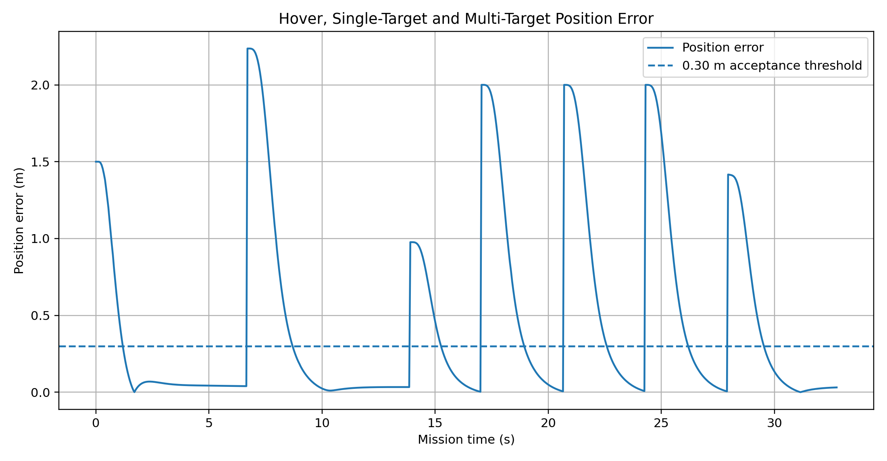
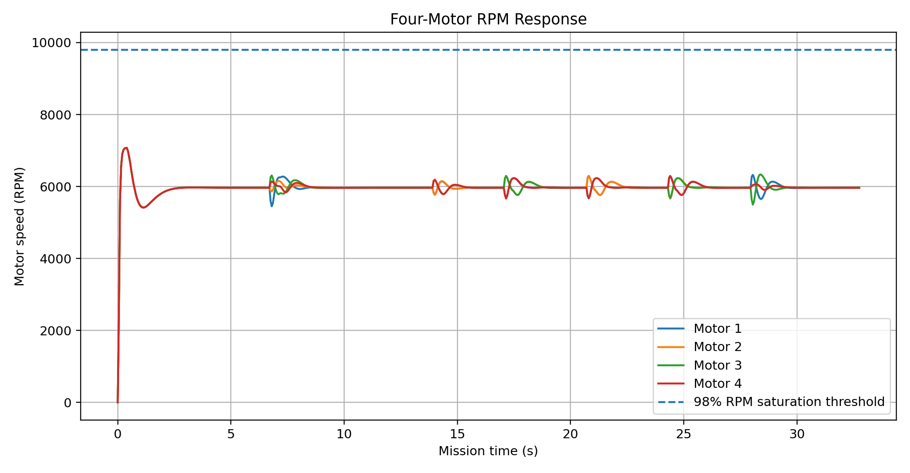
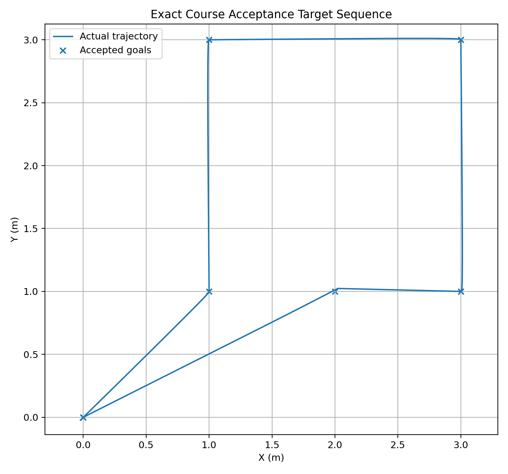
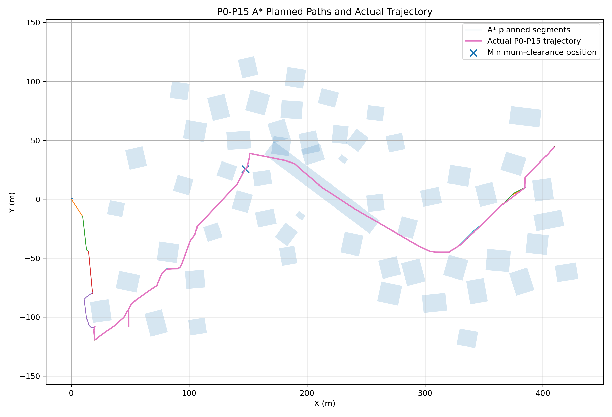
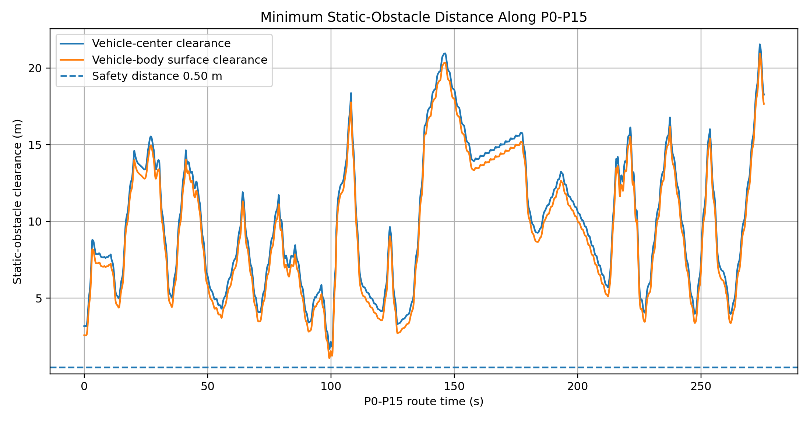
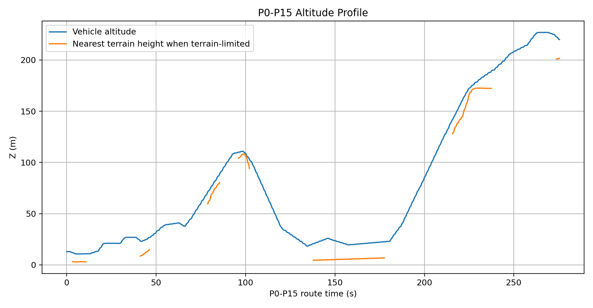

# CQ01：基于 ROS2 的四旋翼自主导航系统

本项目基于 ROS 2 Humble，将六自由度动力学、级联飞行控制、三维 A* 规划、避障、扰动测试、传感器仿真、局部感知、定量评价与重庆山地城市风格场景集成为四旋翼仿真和自主导航系统。

本仓库保存 CQ01 考核项目**冻结的最终提交基线**。最终运行系统有意排除了多无人机功能，以及实验性的端到端神经网络直接电机控制分支。

## 主要功能

- 以四个电机 RPM 指令驱动的四旋翼六自由度刚体动力学；
- 位置、速度和姿态级联控制，包含电机混控与执行器限幅；
- 具有碰撞检查与障碍物膨胀的三维 A* 路径规划；
- 多目标自主飞行与航点执行；
- 静态避障、狭窄通道、桥梁及峡谷穿越；
- 动态障碍重规划与扰动恢复测试；
- 简化 IMU、传感器噪声注入与局部 `PointCloud2` 感知；
- 重庆风格的 CQ01 山地城市场景；
- RViz2 可视化、数据记录、自动评价及教师接口审计；
- 仓库保存可复现的验收证据及实验图表。

## 系统架构

最终版本采用模块化 ROS 2 架构：

```text
任务／目标
    |
    v
三维 A* 规划器 ---> 航点／安全目标
    |                  |
    v                  v
参考轨迹生成 ----> 级联控制器
                         |
                         v
                    四电机 RPM
                         |
                         v
                    六自由度动力学
                         |
                         v
                 里程计／IMU／TF／轨迹
                         |
              +----------+----------+
              |                     |
              v                     v
          评价／记录器           RViz2 可视化
```

主要软件包：

- `src/drone_dynamics/`：六自由度四旋翼动力学；
- `src/drone_controller/`：级联位置、姿态及电机 RPM 控制；
- `src/drone_planner_3d/`：三维规划和碰撞检测；
- `src/cq01_v9_mc/`：冻结版 CQ01 综合任务、A* 规划、记录器、监控面板、可视化及教师接口桥接；
- `src/cq01_requirement_closure/`：传感器噪声桥接、简化 IMU 和局部感知；
- `scripts/run_cq01_nominal_full.sh`：标称配置的最终一键运行入口。

## 运行环境

冻结基线的开发和验证环境：

- Ubuntu 22.04
- ROS 2 Humble
- C++17 与 Python
- Eigen3
- RViz2
- `colcon`

## 快速启动

克隆仓库：

```bash
git clone https://github.com/Zhangchiscu/cq01-ros2-quadrotor-simulation.git
cd cq01-ros2-quadrotor-simulation
```

构建：

```bash
source /opt/ros/humble/setup.bash
colcon build --symlink-install
source install/setup.bash
```

启动冻结版标称 CQ01 综合任务：

```bash
./scripts/run_cq01_nominal_full.sh
```

可用的验证脚本：

```bash
./scripts/check_cq01_teacher_interfaces.sh
./scripts/check_cq01_phase3_strict_after_run.sh
./scripts/audit_cq01_requirement_closure_v14.sh
```

干净仓库有意不跟踪生成的 `build/`、`install/`、`log/` 及体积较大的运行期 `results/` 目录。

## 最终验收结果

冻结版验收涵盖考核要求的六项最低实验。

| 验收要求 | 测试场景 | 结果 | 主要证据 |
|---|---|---|---|
| 悬停 | 在 `(0, 0, 1.5)` 附近悬停 | PASS | `docs/evidence/acceptance_summary.json` |
| 单目标 | 到达 `(2, 1, 1.5)` 并悬停 | PASS | `docs/evidence/acceptance_summary.json` |
| 多目标 | 连续执行四个目标／航点 | PASS | `docs/figures/03_multi_target_actual_trajectory.png` |
| 静态避障 | 在超过五个静态障碍物的 P0–P15 路线飞行 | PASS | `docs/evidence/acceptance_summary.json` |
| 狭窄通道／绕行 | 桥梁、峡谷及走廊穿越 | PASS | `docs/figures/04_route_planned_vs_actual.png` |
| 稳定性展示 | 位置误差、RPM、轨迹、净空和高度 | PASS | `docs/figures/` |

最终验收汇总将六项最低要求全部标记为通过。机器可读证据见：

- `docs/evidence/acceptance_summary.json`
- `docs/evidence/teacher_interface_summary.json`
- `docs/evidence/ACCEPTANCE_REPORT.md`

## 要求提交的实验图表

### 1. 悬停、单目标和多目标位置误差



### 2. 四电机 RPM 响应



### 3. 多目标实际轨迹



### 4. P0–P15 规划路径与实际轨迹



### 5. 最小静态障碍物距离



### 6. P0–P15 飞行高度曲线



## ROS 2 核心接口

严格的教师接口审计检查以下接口：

| Topic／TF | 用途 |
|---|---|
| `/drone/motor_rpm_cmd` | 发送给动力学节点的四电机 RPM 指令 |
| `/drone/odom` | 无人机的位置、速度和姿态状态 |
| `/drone/imu` | 简化 IMU 输出 |
| `/drone/path` | 实际／历史轨迹 |
| `/drone/goal` | 目标位姿 |
| `/map/obstacles` | 障碍地图 |
| `/drone/reference` | 规划器／控制器参考输入 |
| `/drone/waypoints` | 规划航点序列 |
| `/drone/safe_goal` | 局部无碰撞安全目标 |
| `map -> base_link` | 世界坐标系到机体坐标系的动态 TF |

严格接口证据见 `docs/evidence/teacher_interface_summary.json`。

## 坐标系约定

本仿真采用右手笛卡尔世界坐标系：

- `map`：固定世界坐标系；
- `x` 和 `y`：地图水平坐标；
- `z` 正方向：高度增加；
- `base_link`：飞行器机体坐标系；
- 动力学节点发布动态变换 `map -> base_link`。

除非节点明确注明使用了中间机体系量，否则任务目标、障碍物几何、规划路径和实际轨迹均使用一致的地图／世界坐标约定。

## 通过命令行发送目标

控制器通过 `/drone/goal` 接收 `geometry_msgs/msg/PoseStamped`。

示例：

```bash
ros2 topic pub --once /drone/goal geometry_msgs/msg/PoseStamped \
"{header: {frame_id: map}, pose: {position: {x: 2.0, y: 1.0, z: 1.5}, orientation: {w: 1.0}}}"
```

另提供辅助脚本：

```text
src/drone_controller/scripts/send_goal
```

## 地图、碰撞检测与安全性

障碍物尺寸由具体场景配置，并非使用全局固定数值。主要定义位于：

- `src/drone_map/config/obstacles.yaml`
- `src/drone_world/config/*.yaml`
- `src/cq01_v2_scene/config/*.yaml`
- `src/cq01_v9_mc/` 下的最终 CQ01 场景与规划模块。

碰撞检测使用配置的障碍物膨胀／净空参数。验收层会独立测量实际飞行轨迹的障碍物净空。

最终成功判据是：实际最小障碍物距离大于设定的安全阈值。

已跟踪的几何和安全相关配置详情见 `docs/CONFIGURATION_EVIDENCE.md`。

## 规划器行为与失败条件

最终规划链采用具有碰撞检测的三维 A* 和航点生成。

输入：
- 当前飞行器状态；
- 目标位置；
- 障碍地图。

输出：
- 安全参考；
- 航点序列；
- 局部无碰撞安全目标。

典型失败情况：
- 不存在无碰撞路径；
- 起点或终点落在占据空间／膨胀障碍区内；
- 安全膨胀使狭窄通道封闭；
- 所需地图或状态输入不可用；
- 动态障碍使原路径失效，且重规划无法找到可行替代路径。

最终仓库包含静态避障、P0–P15 路线净空、桥梁／峡谷狭窄通道和动态重规划实验。

## 加分项：轨迹输入

除必做的目标点任务外，还实现了可选的轨迹输入功能。

实现模式：
- 圆形轨迹；
- 八字轨迹；
- 航点列表／多目标轨迹。

相关软件包：
- `src/drone_pattern_trajectory/`
- `src/drone_multigoal/`
- `src/cq01_v9_mc/` 下的轨迹模式管理、任务编排与评价模块。

## 重庆 CQ01 场景

CQ01 是受重庆山地城市启发设计的工程压力测试场景，主要考察规划器与控制器在以下条件下的表现：

- 显著高差；
- 密集建筑；
- 狭窄通道；
- 桥梁／峡谷几何；
- 多阶段长距离航线；
- 静态与动态障碍物；
- 外部扰动；
- 感知和传感器噪声测试。

场景定位是工程压力测试环境，而非对真实建筑分布进行测绘级精度重建。

重庆场景可视化与数据相关包：

- `src/drone_chongqing/`
- `src/drone_chongqing_cq01/`
- `src/drone_chongqing_fullscene/`
- `src/drone_chongqing_map/`
- `src/drone_chongqing_realdata/`
- `src/cq01_v2_scene/`
- `src/cq01_v9_mc/`

## 最终运行系统与开发阶段软件包

由于采用增量开发方式，仓库保留了开发阶段和回归测试软件包。

### 冻结的最终运行系统

面向教师验收的最终链路以以下内容为中心：

- `src/drone_dynamics/`
- `src/drone_controller/`
- `src/drone_planner_3d/`
- `src/cq01_v9_mc/`
- `src/cq01_requirement_closure/`
- `scripts/run_cq01_nominal_full.sh`

### 开发／回归测试支持

早期 CQ01 版本或带 `regression` 名称的软件包，保留扰动回归、高空阵风检查、可视化迭代和基准测试等开发阶段证据。

`drone_world_validation`、`drone_robustness`、`drone_dynamic_replanning` 等通用软件包，以及分析／评价模块，属于辅助测试基础设施，并非与最终控制器竞争的另一套正式实现。

冻结范围及排除项见 `FINAL_BASELINE.md`。

## 与参考仓库的关系

考核题目提供的仓库仅用作设计参考，并非直接复制为最终运行系统。

| 参考项目 | 借鉴内容 | 本仓库独立实现的内容 |
|---|---|---|
| `pengyu_sim` | 面向 ROS 2 的仿真任务分解，以及动力学、控制与可视化解耦思路 | `drone_dynamics`、`drone_controller`、教师接口桥接、验收工具及 CQ01 综合启动链 |
| `MARSIM` | 三维／点云地图及局部感知概念 | 本地 `PointCloud2` 表示、局部感知裁剪、三维规划与碰撞检查链 |

最终提交系统运行时不依赖上述两个参考仓库。

## AI 使用及人工验证

开发期间使用 AI 辅助代码初稿、调试、文档编写、实验分析和替代控制方案探索。

最终功能均经过人工集成、执行、检查，并利用仓库中的验收和回归工具验证。

开发阶段曾探索循环神经网络直接电机控制策略，但未能实现可靠的闭环悬停。因此将其明确记录为失败的研究实验，有意排除在冻结的最终运行系统之外。

详见 `ai_usage.md`。

## 仓库目录结构

```text
.
├── docs/                 # 验收证据、需求追踪与图表
├── report/assets/        # 实验结果及定量分析
├── scripts/              # 最终运行、审计和评价脚本
├── src/                  # ROS 2 软件包
├── FINAL_BASELINE.md     # 冻结版范围和排除项
├── ai_usage.md           # AI 使用披露及失败的 AI 控制探索
└── README.md
```

## 可复现性与可追溯性

主要追溯资料：

- `docs/REQUIREMENTS_TRACEABILITY.md`
- `docs/CONFIGURATION_EVIDENCE.md`
- `docs/evidence/ACCEPTANCE_REPORT.md`
- `docs/evidence/acceptance_summary.json`
- `docs/evidence/teacher_interface_summary.json`

最终干净仓库排除了生成的构建产物和大型运行结果目录，但保留检查与复现最终提交基线所需的源码、配置、脚本、图表和机器可读验收证据。

## 范围与局限

冻结的最终运行系统有意排除：
- 多无人机运行；
- 实验性端到端神经网络直接电机控制。

最终提交的验证系统包括经典动力学、控制器、三维规划、重庆场景、扰动、传感器和评价链。

## 许可与数据说明

仓库目前包含组件级许可证和数据许可说明：

- `src/drone_dynamics/LICENSE`
- `src/drone_chongqing_realdata/web/DATA_LICENSE.md`

尚未添加覆盖全仓库的统一许可证。仓库公开可见并不意味着所有源码、数据和由第三方素材衍生的资源都已获得统一的再利用许可。复用前应分别检查组件与数据许可声明。
